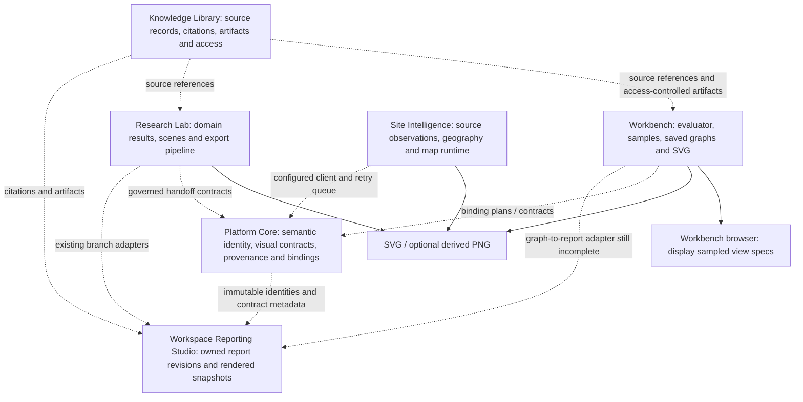

# Sustainable Catalyst visualization architecture reconciliation

Audit date: 2026-10-29 (America/Chicago). Status: source audit and isolated correction; no production deployment, database change, service restart, merge, or platform build.

## Decision

Reuse Platform Core for governed visualization specifications, renderer/version compatibility records, semantic identities, immutable snapshots, provenance and cross-product binding contracts. Keep scientific sampling, actual SVG drawing and format conversion in existing specialist runtimes. Core's implemented visualization services explicitly reject Core-side renderer execution and scale calculation. A renderer-family registry entry does not mean Plotly, Vega-Lite, D3 or MapLibre is installed or serving a product.

UVR-01.3.7 is an export display-range defect in an unreconciled Workbench image, not a missing Core rendering engine. Recover that existing implementation, correct its bounds, and certify it against the browser and existing report utility. Do not introduce a new visualization service.

## Evidence method and limits

Cloned all six repositories with fetched remote branches and history. Inspected current READMEs, architecture/integration documents, source, deployment definitions, tests, release history and relevant open PR stacks. GitHub releases collections returned no release objects for all six repositories; release claims therefore come from source/history and documentation, not published release assets. Existing tests are implementation evidence, not proof they passed on the deployed image.

Read-only production checks: public Workbench OpenAPI, container/image identity, source files, source hashes, router inclusion, source-related Docker diff, frontend hashes, and data mount identity. Did not read environment values, credentials, account sessions, research records or database contents. Did not execute application imports inside production, which could initialize storage. No production API create/render operations were used. No production changes were made.

Other products' production deployments and cross-product credentials/bindings were not verified. Documentation-only certification, seeded feature flags and capability dictionaries are not treated as a live integration. Exact originating Workbench image commit is unavailable: no `/app/.git` or revision label was found. Byte fingerprints establish the recovered implementation, not its original author or build commit.

## Source inventory

| Repository | Audited main SHA | Additional source reviewed | State relevant to visualization |
|---|---|---|---|
| Platform Core | `16ffc6585ee0def6f3005ce024dd92eb8ae7db7c` | v2.29/2.30, v2.61–2.71 services and tests; v4.20.2 provider contract; integration/deployment docs; PRs #1–4 | Persisted registries, specifications, compatibility resolution, scenes, grammar and handoff records implemented. Actual SVG/PNG renderer deliberately excluded. Live bindings not verified. |
| Workbench | `7f7c23fd609386619f95ba9a4f932bbdca097b3b` | UVR stack #31–35; ERW/reporting branches #1–28; v8.9 Figure Composer, v11.16 graph execution, v12.1 auth, v12.2 persistence, v13.5 studio; production export source | Main lacks export route. UVR #35 fixes browser only. Production contains additional Python export code absent from fetched history. |
| Research Lab | `39fdefb3ff9cc73262b7d748cb44d2599094ae5a` | Universal export docs and `assets/js/modules/visualization.js`; numerical/3D/4D modules; Core certification docs; PRs #1–3 | Existing SVG, browser PNG/PDF, CSV/JSON/ZIP pipeline implemented. It remains Lab-specific; a saved packet/localStorage handoff is not a confirmed server-side report attachment. |
| Site Intelligence | `43660fb002e7d892442473dfd323dbab4f6fd68e` | Core client, geospatial/ocean render assets and briefing/export modules; PRs #2–6 | Live-source rendering and source-aware briefing exports implemented; Core client is configuration-gated with queued writes. Current enabled state/replay success not verified. Production source reconciliation is itself an open PR (#2). |
| Knowledge Library | `81c3ad7e1a19d7cdfa0f58032b98925e3ca96402` | direct-service integration, provenance and artifact service code, access contracts; PRs #1–2 | Owns Library source/artifact records and access. Consumer capability metadata and signed exchange contracts exist; no evidence all clients are configured or that graph images are stored there. |
| Workspace | `fb932c18f4f88985297ef770128157795a5892f8` | Reporting PR stack #7/#9/#10; `codex/reporting-studio-g1-handoff` at `f640b2628e645af77c2ac3297919073e600d3926`; WXR build map | Reporting Studio is existing branch implementation, not a separate new repository or proven deployment. Persistent project revisions/object store, saved rendered views, bounded math typesetting, Lab adapters and heatmaps exist. Real login/durability/production gates remain open in ledger. |

Workbench README claims v10.4.0 while `release.py`, main history and live OpenAPI identify v14.0.0. Treat README version as stale. Old integration documents (e.g. SI v1.15.1 targeting Core v2.5.0) need contract compatibility checks against current Core, not blind execution of old deployment commands. Root cleanup archives preserve historical build/release material in Core and Workbench; source history was used before proposing work.

## Current dependency and authority map



Solid edges are local implementation paths. Dashed edges describe adapters/contracts or flows whose live end-to-end operation was not verified; they are not assertions of a working deployment.

| Concern | Current authority / implementation | Reconciliation |
|---|---|---|
| Numerical calculation and samples | Workbench `v11160.execute_graphing`, SymPy/lambdify and existing computation modules; Lab retains its domain calculations | Keep outside Core graph contracts. Core has some bounded uncertainty/summary utilities elsewhere; that is not a reason to relocate graph sampling. |
| Saved graph specification | Workbench `v1350` owner-scoped SQLite graph/project/session records; `graphObjectHash`, `renderHash` | Preserve product-local graph IDs. Bind them to Core entities explicitly; do not equate IDs. |
| Governed visual meaning | Core `visual_reasoning`, `visualization_registry`, `visual_runtime`, `visual_grammar`, `visual_composition`, cross-product integration services | Reuse existing registries and immutable revisions. These are implemented services/models/routers, not merely proposals. |
| Browser drawing | Workbench `math-renderer.js`; older WordPress client renderers also remain | Reuse its display policy for export and test numerical geometry. DOM display is not sampled-data authority. |
| SVG/PNG | Production Workbench `graph_svg.py`; JS `report-svg-export.mjs`; Lab SVG-to-PNG/PDF; SI map/briefing exports | Correct existing Python export. Consolidate Workbench bounds in one JS helper and cross-language fixtures. Reuse Lab conversion approach where compatible; do not add a Core export endpoint. |
| Source provenance | Library owns its source/citation/artifact records; Core governs cross-product semantic/evidence lineage; products own result and execution metadata | Retain source hash/revision, units, assumptions, missingness and qualifications. Rendering is not scientific verification. |
| Report identity and persistence | Workspace Reporting Studio branch `repository.py`, `object_store.py`, `research_reporting.py` | Use owned persistent-project API and immutable source/render bindings. Do not create another report store. |
| Access control | Workbench signed bearer subject and `_graph_row` owner lookup; Core internal keys/public scopes; Library signed service/scoped access; Reporting signed cookie + same-origin write checks + owned object reads | A Core reference or renderer registry lookup must never confer graph/artifact access. Validate both producer and consumer scopes; no browser write keys. |

## Production route trace and source drift

1. Browser `downloadActiveGraphSvg` in `standalone-app/app-shell.js` sends an authenticated GET to `/standalone/v1/graph-studio/graphs/{graph_id}/export.svg`.
2. Public OpenAPI confirms that route, `export_svg_route` operation, authorization header and Workbench version 14.0.0. OpenAPI's default JSON success schema is inaccurate for the actual SVG Response; documentation cleanup is separate.
3. Container `sc-workbench`, working directory `/app`, image tag `sc-workbench:uvr-01-3-5-candidate`.
4. Immutable local image identifier: `sha256:d62871ffa9b2acf5a6b1e87ecc0fdc3bea7a7d6905caaf454a3c3bb591c7bbdb`. Image created at `2026-10-29T05:52:31.715569576+01:00` (as reported by Docker).
5. `/app/app/main.py:714–715` imports and mounts `app.v1350.router`. `/app/app/v1350.py` adds a `Response` import, `graph_svg.render_svg` import and export route after existing render route.
6. Route derives owner using `_owner(authorization)`, then calls `render_graph(graph_id, owner)` and passes returned graph/project identities to `render_svg`. `_graph_row` selects by graph ID **and** owner. The implementation does not trust owner/project fields from a download request body.
7. `/app/app/graph_svg.py` validates finite numeric series, identity fields, hashes, dimensions and sample bound, builds SVG, hashes SVG bytes and a provenance manifest, and returns them to the route.
8. Response retains `image/svg+xml`, attachment name, `nosniff`, CSP sandbox, private/no-store, SVG SHA-256 and provenance SHA-256 headers.
9. Data mount is a bind from `/opt/sustainable-catalyst/workbench/data` to `/data`; no data files were read or copied.

Source SHA-256 fingerprints:

| Deployed file | SHA-256 |
|---|---|
| `/app/app/v1350.py` | `84117047772d740e477a9fbff059cd579dec99550e5a0af95135b8f28bf8d2d8` |
| `/app/app/graph_svg.py` | `abe80e1ddfdb71b2cb7a288804f9f6c5841df18c0c4ec05ba03e0aed933278ad` |
| `/var/www/workbench/math-renderer.js` | `c5d8ba76f50450e8b68bf5da2d3f66a1b1d53c149ae93e5406b58b7b057d3407` |
| `/var/www/workbench/app-shell.js` | `dbb1673c9fa122f213e1393a3be4ad5914f60a82802c0bea6f14edaa7c5fec68` |

Both frontend hashes match UVR #35 head `17118f03008cb2472a7a5d3c54bdba613b71b2ee`. The clean Pi checkout also matches that head. Neither `graph_svg.py` nor the route occurs in fetched Workbench remote history (`git log --all -- backend/app/graph_svg.py`, and pickaxe search for `def export_svg_route`). The container has no reported writable-layer changes for these source files; only `/data` is mounted. Conclusion: an **unreconciled candidate image source addition**, rather than a demonstrated change made inside the running container. Whether that image was built from an uncommitted working tree or an unavailable source revision cannot be established from this evidence. Do not invent a commit SHA for it.

Recovered exact code into a separate Pi worktree `/mnt/catalyst-ssd/workbench-svg-parity`, branch `codex/uvr-01-3-7-svg-export-parity`. The original Pi UVR checkout remains intact. Recovery commit is separate from numerical changes for review. No production configuration, data, secret or session is included.

## UVR-01.3.7 cause and correction

The browser guard in PR #35 handles roundoff; the deployed Python exporter and JS report utility expand only exactly equal y-extrema. With 401 identity samples, actual y-extrema are `0.9999999999999998` and `1.0000000000000002`. Dividing by that tiny range stretches roundoff over the full 410-pixel export plot height.

Correction changes display bounds only. For y-extrema a,b, classify their spread as roundoff when `b-a <= 32 * binary64 epsilon * max(abs(a),abs(b))`. Center the display interval on `a+(b-a)/2`; for a near-constant series use span `max(1e-12,abs(center)*0.2)`. Otherwise retain the actual extrema. This is a declared rendering tolerance, not a scientific uncertainty estimate or mathematical proof of constancy. Do not round or replace samples, simplify the expression, mutate saved graphs, or recompute scientific values in an export utility.

The old browser magnitude floor was removed from the noise threshold so genuine variation at `1e-30` remains visible. The display-span floor applies only after classifying an effectively constant series. Two distinct horizontal series retain their separation because classification uses the plotted extent.

`display-range.mjs` is a small shared helper for the two existing JS renderers. Python implements the same rule with shared fixtures; cross-language parity tests compare bounds and normalized SVG point geometry. There is no new drawing engine. Browser and export retain their existing margins and styling.

Recorded synthetic result: before correction, vertical spread **410.0 px**; after, **0.0 px** at the export's two-decimal coordinate precision. Both render all 401 original samples. See regression-evidence.json and before/after SVG artifacts.

Validation covers constants (positive, negative, zero), identity samples, explicit floating-point noise, real variation around 1, `1e-12` and `1e-30`, multiple series, preserved inputs, invalid numeric data, mismatched identities, deterministic bytes, provenance and SVG hashes, XML escaping, missing/invalid authentication, cross-owner 404, attachment/security headers, and unchanged saved graph after export. Tests use synthetic records and temporary SQLite only.

Limits: current browser renders views as separate cards; existing export merges views into one chart. The correction certifies single-view coordinate equivalence and the reported identity defect, not universal layout equivalence for linked derivative/integral multi-panel studies. Markers/annotations, viewport choices, nonlinear scales, discontinuity gaps and full multi-panel composition need explicit contract/acceptance work before claiming all Graph Studio exports reproduce every browser feature. This change preserves those existing behaviors rather than broadening the renderer.

## Duplication and integration assessment

| Existing overlap | Assessment and next action |
|---|---|
| Browser, JS report utility and recovered Python SVG exporter choose ranges independently | Immediate defect source. Share JS helper now; lock Python parity with fixtures. Eventually retire the pure JS report exporter if all its consumers can use authenticated immutable server artifacts; first prove call sites and ownership behavior. |
| Workbench Graph Studio vs v8.9 Figure Composer | Both legitimate existing pathways with different IDs: saved expression studies vs execution-job metric panels. Reuse `figure-composer-adapter.mjs`; it demands an explicit verified graph/project/job mapping. Do not fabricate an ID equivalence or migrate storage during this fix. |
| Core renderer registry, scene/composition/grammar services | Reusable governance, not duplicate drawing code. Register actual Workbench renderer/version capabilities after approval, using existing APIs. Seeded renderer contracts do not replace runtime dependency verification. |
| Lab universal export and multiple specialized numerical/3D/4D renderers | Existing conversion/provenance machinery should stay authoritative for Lab outputs. Share artifact conventions and replay fixtures; do not replace scene execution with a generic 2D Workbench plot. Audit active module loading before deleting historical modules. |
| Reporting adapters, heatmap rendering, MathJax typesetting | These operate on explicitly supported source schemas, with saved rendered snapshots and immutable bindings. Typesetting is presentation, not a CAS evaluator. Reuse reporting storage/composition; its Workbench graph-view-spec ingestion is not yet implemented in the inspected dispatch. |
| SI map/ocean/briefing exports | Specialized geography and source freshness are not equivalent to Cartesian function plots. Preserve CRS, spatial/time coverage, observations vs modeled/interpolated classifications, and its backend-only Core credentials/queue. |
| Library provenance vs Core provenance | Complementary scopes: Library source/artifact custody and access, Core cross-product governed meaning, product execution lineage. Reference records across systems instead of duplicating authoritative datasets or storing private source bytes in public figure metadata. |
| Documentation “certification” vs deployed reality | Feature flags, plans, stored packets and successful test reports do not prove an enabled route or authenticated end-to-end workflow. Keep a per-candidate evidence ledger. |

Reporting discovery resolved: Workspace PR #10 is based on #9, which is based on #7, not on main. `research_reporting.py` uses `/v1/private-research/persistent-projects`; the older `/v1/private-research/projects` is a different registry and must not be used as a replacement. Feature gate requires `SC_WORKSPACE_REPORTING_STUDIO_ENABLED=1`. Source artifacts must match owner, project, immutable revision and digest; stale saves return 409; reopening verifies source/rendered hashes. The branch supports particular Lab exports/heatmaps and bounded Workbench math-object bindings, and explicitly rejects unsupported schemas. Its ledger records synthetic SQLite/PostgreSQL checks but still blocks genuine-account acceptance, durable mount/replacement and production comparison. A function called “shared graph renderer” in Workspace also exposes capability/profile metadata; that profile alone does not establish installed layout or drawing execution.

## Proposed shared contract using existing infrastructure

This is a proposal, not a new service or applied migration.

1. Producer retains scientific source and execution authority. Return immutable graph/result reference, project/session bindings, source/input hashes and revisions, sampled views, units, assumptions, uncertainty/missingness and diagnostics where supplied. Missing scientific metadata stays missing; do not infer it from labels.
2. Map those references to existing Core visual reasoning entity + visualization specification, renderer registry/version, scene/view/grammar and cross-product binding records. Use existing hash/revision semantics and record mapping provenance. A Workbench `graphObjectHash` is not automatically a Core entity ID or a Library artifact ID.
3. Declare renderer capability and policy metadata: binary64 sample interpretation, display tolerance/version, range mode, panel boundaries, dimensions, scales, discontinuity behavior, series visibility/order, markers, annotation handling, accessibility and export formats. Core governs intent; product code calculates bounds and draws it.
4. Producer authorizes export using its current subject/owner checks and freezes the authorized source/render revision used for the artifact. Store or return SVG bytes + byte digest + a resolvable provenance manifest; future metadata must include exact renderer/display-policy version and session/source links. Current recovered SVG embeds only the provenance digest, so it is not a self-contained provenance package by itself.
5. Derive PNG from that exact SVG when supported. Bind format/size/converter version and hashes to the artifact. Do not resample functions for PNG or silently rerender a saved report on reopen.
6. Reporting accepts an authenticated, same-project immutable artifact/reference through its existing owned object store and report revision flow. Add one explicit Workbench adapter to its existing schema dispatch after contract review; preserve source and rendered bytes. No independent report database, new plotting engine or private source duplication.
7. Lab/SI adapters retain domain qualification, scene/CRS/time metadata and upstream IDs. Library supplies authorized citation/source references. Core records semantic handoffs and synchronization evidence; it does not execute product handoffs or grant producer data access.
8. Failed or unavailable integration remains explicit. A queued Core write is pending, an export hash is byte identity, a compatible registry resolution is metadata, and rendering/reproducibility never imply verified scientific truth.

## Prioritized build and deployment map

| Priority / build | Scope | Exit evidence | Approval boundary |
|---|---|---|---|
| P0-A: source recovery | Exact deployed Python export and route, separate recovery commit | Source hashes, image ID, sanitized diff, Pi recovery location | Code review PR; no production action |
| P0-B: numerical correction | Shared display policy and export/browser parity; focused CI | Python + JS tests locally and Pi; flat identity SVG; genuine small variation preserved | PR review required before merge |
| P0-C: release preparation | Reconcile candidate image's remaining source against full reviewed repository, not just v1350 | Complete source manifest, base-image/dependency lock, verified build context, isolated image digest; no unrelated ERW regressions | Approval required before deployment; do not rebuild from main and lose unmerged functionality |
| P0-D: approved Contabo release | Existing container/data path and frontend assets, no Pi production role | Paired image/frontend backup; isolated smoke; browser/download check on approved test graph; headers and hashes | Separate explicit approval; operator executes controlled change |
| P1-A: Core mapping | Reuse visualization registry/spec/scene/grammar and existing Workbench binding plans | Readiness + version/scopes checked, one owned graph binds to known Core ID; denied cross-owner case | Contract review; no new Core renderer |
| P1-B: Reporting adapter | Reuse Workspace immutable object/report revision store | Graph/SVG/provenance ingest, stale-revision 409, cross-project/owner denial, save/reopen without rerender; real login and durable restart proof | Existing Reporting stack must meet its blocked gates first |
| P1-C: render fidelity | Define multi-view layout, annotations, markers, discontinuities, viewport/scales | Browser vs SVG/PNG comparisons for single/multiple/linked studies; policy version in manifest | Review modest product renderer changes separately |
| P2-A: common artifacts | Reuse Lab SVG conversion path/conventions and Library artifact references | SVG-derived PNG consistency, missing conversion runtime fails clearly, source/units preserved | Review dependency/license/runtime packaging |
| P2-B: retire duplication | Trace consumers of legacy WP/export helpers before removal | Consumer inventory and regression suite prove replacements; rollback retained | Approval before major consolidation |
| P2-C: documentation/deployment ledger | Align READMEs, build maps, candidate source/revision labels | Source SHA + image digest + deployment attestation per product | Isolated documentation/build changes |

## Reproducible validation

From Workbench repository root in a disposable development environment:

```sh
python3 -m venv .venv
.venv/bin/python -m pip install -r backend/requirements.txt
PYTHONPATH=backend .venv/bin/python -m pytest -q backend/tests/test_uvr_svg_export_precision.py
node --test standalone-app/tests/uvr-*.test.*
git diff --check
```

Verified results: **18 Python tests and 58 Node tests passed on both Mac and Raspberry Pi**. Pi Python: 18 passed, one existing Pydantic warning, 5.71 s. Mac Python: 18 passed, two dependency/model warnings. Node: 58 passed, zero failures on each host. Logs are delivered separately.

Pi worktree: `/mnt/catalyst-ssd/workbench-svg-parity`; disposable test venv `/mnt/catalyst-ssd/workbench-svg-parity-venv`. No production credentials are needed. Node parity tests invoke `python3` for the pure export module; Python integration tests use the venv. CI is scoped to this regression set; no claim is made that the entire historical release suite passes.

## Deployment and rollback procedure (proposal; not executed)

Before requesting deployment approval, preserve the existing image by immutable ID in an operator-controlled backup, fingerprint **all** candidate source rather than assuming a branch tag equals production, and archive the current frontend asset set including its imports. Preserve current persistent data with the existing approved backup procedure; validate an offline restore using a disposable clone. No schema migration is needed by this patch.

Build/test a new reviewed candidate on the Pi or another approved build host; the Pi remains development/testing/sync/backup only. Use an isolated test data directory, container name and loopback port. Record source commit and image digest. Do not run current production upgrade scripts merely because their version name looks relevant: several create verification records or restart services. The production image contains other unmerged ERW additions, so this narrow recovery does **not** authorize replacing it with a clean main-based image.

After separate approval, deploy only the reviewed image to Contabo and the matched frontend `math-renderer.js` plus new `display-range.mjs` dependency if that refactor is included. Keep old frontend and image available as one release pair; verify static MIME/import paths and caching. Test an authorized approved synthetic identity graph and real small variation, SVG headers/hash and private access behavior. Do not publish research bytes in test evidence.

Rollback trigger: missing import/route, visual regression, authentication/ownership regression, unexpected data mutation or failure to reopen existing graphs. Restore the previous Contabo image by preserved immutable ID and restore the previous frontend asset pair. Keep the existing data mount and configuration. This patch needs no database rollback; if unrelated deployment damage affects data, stop and use the existing operator-approved paired restoration procedure. Recheck authenticated graph access/export and source hashes. A rollback itself is a production change and requires approval; no command in this audit performs it.

## Review links

- [Workbench UVR #35: browser-only precision fix](https://github.com/Content-Catalyst-LLC/sustainable-catalyst-workbench/pull/35)
- [Workbench UVR #34: download UI](https://github.com/Content-Catalyst-LLC/sustainable-catalyst-workbench/pull/34)
- [Workbench UVR #33: reporting foundation](https://github.com/Content-Catalyst-LLC/sustainable-catalyst-workbench/pull/33)
- [Core registry implementation](https://github.com/Content-Catalyst-LLC/sustainable-catalyst-platform-core/blob/16ffc6585ee0def6f3005ce024dd92eb8ae7db7c/backend/app/services/visualization_registry.py)
- [Core grammar execution boundaries](https://github.com/Content-Catalyst-LLC/sustainable-catalyst-platform-core/blob/16ffc6585ee0def6f3005ce024dd92eb8ae7db7c/backend/app/services/visual_grammar.py)
- [Core cross-product integration](https://github.com/Content-Catalyst-LLC/sustainable-catalyst-platform-core/blob/16ffc6585ee0def6f3005ce024dd92eb8ae7db7c/backend/app/services/cross_product_visual_runtime_integration.py)
- [Lab existing visualization/export code](https://github.com/Content-Catalyst-LLC/sustainable-catalyst-lab/blob/39fdefb3ff9cc73262b7d748cb44d2599094ae5a/assets/js/modules/visualization.js)
- [Site Intelligence Core client](https://github.com/Content-Catalyst-LLC/sustainable-catalyst-site-intelligence/blob/43660fb002e7d892442473dfd323dbab4f6fd68e/backend/app/platform_core_integration.py)
- [Library direct-service contracts](https://github.com/Content-Catalyst-LLC/sustainable-catalyst-library/blob/81c3ad7e1a19d7cdfa0f58032b98925e3ca96402/library-backend/app/cross_product_integration.py)
- [Workspace Reporting Studio #7](https://github.com/Content-Catalyst-LLC/sustainable-catalyst-workspace/pull/7), [packaging #9](https://github.com/Content-Catalyst-LLC/sustainable-catalyst-workspace/pull/9), [G1 handoff #10](https://github.com/Content-Catalyst-LLC/sustainable-catalyst-workspace/pull/10)
- [Reporting implementation and limits](https://github.com/Content-Catalyst-LLC/sustainable-catalyst-workspace/blob/f640b2628e645af77c2ac3297919073e600d3926/docs/reporting-studio/G1/IMPLEMENTATION.md), [acceptance ledger](https://github.com/Content-Catalyst-LLC/sustainable-catalyst-workspace/blob/f640b2628e645af77c2ac3297919073e600d3926/docs/reporting-studio/G1/ACCEPTANCE.md)

## Prepared draft pull requests

- [#36 — recovered source and SVG precision correction](https://github.com/Content-Catalyst-LLC/sustainable-catalyst-workbench/pull/36), head `b9b386fefb7d0f7882ca25eb913c4f8f6f292403`, stacked on #35.
- [#37 — architecture audit and integration build map](https://github.com/Content-Catalyst-LLC/sustainable-catalyst-workbench/pull/37), independent documentation change against main.

Both are draft and unmerged. Approval is still required for merge and production deployment.

Exact-head GitHub CI passed for correction commit `b9b386fefb7d0f7882ca25eb913c4f8f6f292403`: [run 40926301715](https://github.com/Content-Catalyst-LLC/sustainable-catalyst-workbench/actions/runs/40926301715). Pi worktree is clean at that commit.
